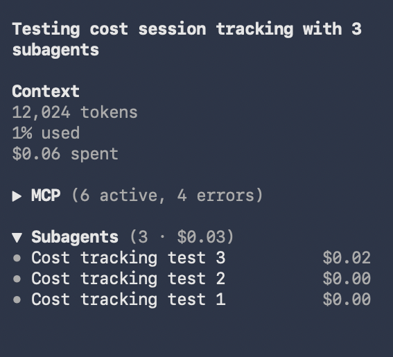

# opencode-session-cost

[](https://www.npmjs.com/package/opencode-session-cost)
[](https://github.com/igorvelho/opencode-session-cost/actions/workflows/ci.yml)
[](LICENSE)

OpenCode 2.x includes subagent spend in the session total, but doesn't show
how much came from subagents or which subagent cost what. This plugin adds a
collapsible **Subagents** block to the [OpenCode](https://opencode.ai) sidebar
when a session spawns subagents, showing the subagent count, combined subagent
spend, and an expandable per-subagent cost breakdown.



## Installation

Requires **OpenCode 2.0.28 or newer (2.x)**. This is a **TUI-only** plugin.
It has no server-side hook and must be added to the global
`~/.config/opencode/cli.json`, not `opencode.json` or the V1 `tui.json`.

### Quick install (recommended)

Until a V2-compatible version is published, use the local checkout below.
For a published V2-compatible package, add it to your global `cli.json`:

```json
{
  "plugins": ["opencode-session-cost"]
}
```

Restart the OpenCode TUI afterwards for the sidebar block to appear.

### Manual install

Merge this into your global `cli.json`, preserving other settings and plugins:

```json
{
  "plugins": [{ "package": "opencode-session-cost", "options": { "enabled": true } }]
}
```

Using a local checkout instead of the npm package? Run `bun install` and
`bun run build` first, then point at the directory:

```json
{
  "plugins": [
    { "package": "/absolute/path/to/opencode-session-cost", "options": { "enabled": true } }
  ]
}
```

Restart the OpenCode TUI after building or editing `cli.json`.
When `XDG_CONFIG_HOME` is set, use `$XDG_CONFIG_HOME/opencode/cli.json` instead.

### Options

| Option    | Type    | Default | Description                                                          |
| --------- | ------- | ------- | ---------------------------------------------------------------------|
| `enabled` | boolean | `true`  | When `false`, the plugin's `setup()` returns immediately and registers nothing. |

There is no provider allow-list and no other configuration — this works
for every session regardless of model or provider.

## Development

```bash
bun install
bun run typecheck   # tsc --noEmit
bun test            # bun:test, pure logic in src/cost.test.ts
bun run build        # Bun.build (JSX) + tsc --emitDeclarationOnly (types)
```

## Contributing

Contributions are welcome. See [CONTRIBUTING.md](CONTRIBUTING.md) for
development setup, coding standards, and the pull request process.

## License

MIT — see [LICENSE](LICENSE).
