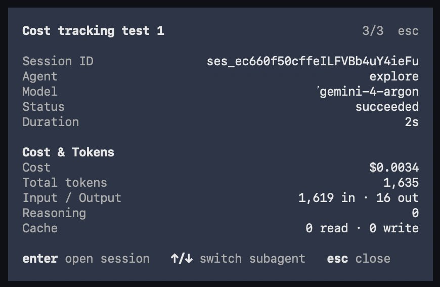

# opencode-session-cost

[](https://www.npmjs.com/package/opencode-session-cost)
[](https://github.com/igorvelho/opencode-session-cost/actions/workflows/ci.yml)
[](LICENSE)

OpenCode 2.x includes subagent spend in the session total, but doesn't show how much came from subagents or which subagent cost what.

This plugin adds a collapsible **Subagents** block to the [OpenCode](https://opencode.ai) sidebar whenever a session spawns subagents, showing the subagent count, combined subagent spend, and a per-subagent cost breakdown.


Click any subagent in the list to open its **session details** dialog with the agent, model, status, duration, 4-decimal cost, token breakdown, and shortcuts to switch between subagents or jump directly into that subagent's session:



## Install

Requires **OpenCode 2.x**. Run:

```bash
opencode plugin add opencode-session-cost
```

Restart the OpenCode TUI and the **Subagents** section will appear automatically whenever a session uses subagents.

## Contributing

Contributions are welcome. See [CONTRIBUTING.md](CONTRIBUTING.md) for development setup, coding standards, and the pull request process.

## License

MIT — see [LICENSE](LICENSE).
